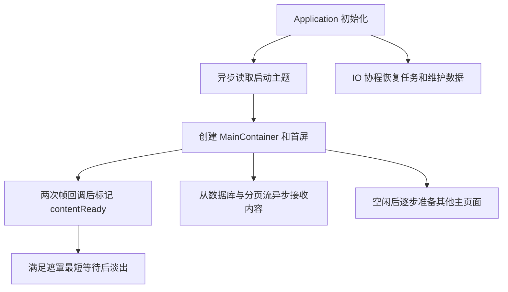

# EaraAsmrPlayer 启动加载与页面切换源码分析

分析日期：2026-11-17。目标为 GitHub HEAD `448f5ef19262f157c1f8f5a50ca135e9db06b5cd`，提交日期 2026-11-08。本地对照为 SubtitleEditforAndroid `f742579b2e79239055391374876c2753cc3b6af3`。本次只读源码，没有编译、安装或实测 Eara，没有修改本应用的生产代码。

其主要做法是：首屏优先，空闲时分阶段准备并保留主页面；保留的隐藏页停止数据收集和动画；详情页覆盖在主页面上，使用图层位移完成转场。部分工作被转移到首次点击之前，部分离屏工作被停止，部分是通过不同的交互设计直接减少了转场成本。不能据此断定其冷启动或所有页面渲染更快。

## 1. 启动顺序与加载边界

`AsmrApp.onCreate()` 将清理睡眠定时器、数据库任务检查、字幕恢复、下载恢复及旧字幕回填放进 `SupervisorJob + Dispatchers.IO` 的应用协程。字幕任务和下载任务先检查数量，有需要才进入恢复流程。`appCacheManager.start()` 的主要工作也在 IO 协程中，但 PDFBox 初始化仍直接调用于 Application 启动路径，不能概括为所有初始化都离开主线程。[S1]

`MainActivity.onCreate()` 先异步等待 `loadThemeBootstrapPreferences()`，该方法在 IO 上获取 DataStore 的首个主题快照，然后才调用 `setContent`。这避免先用默认主题绘制、再切换用户主题，但主题读取仍是首帧的依赖。播放封面占位图另在 IO 预载，动态主题还可以使用持久化的颜色种子暂时恢复上次外观。[S2]

启动遮罩不是“媒体库全部加载完成”的屏障。`MainContainer` 仅等两次 `withFrameNanos` 就调用 `onContentReady()`；遮罩有 240 ms 的最短等待，满足 ready 后进行 180 ms 淡出。网络、库数据、其他页面预热可继续进行。两次帧回调也不能等同于所有像素已显示在屏幕上。[S2][S3]

本地库主列表采用 Room Paging，`pageSize=40`、`prefetchDistance=10`，并在 ViewModel 内 `cachedIn`。这两个数字是分页配置，不能误读为首发只加载 40 条；代码未显式指定 `initialLoadSize`。映射与部分派生计算使用 Default 调度器。自动文件扫描仅在没有已有专辑、且有扫描根或下载内容时尝试，额外等待 450 ms；并非每次启动都先全库扫描。[S4]

## 2. 主页面保留与底部切换

八个主页面是本地库、搜索、热门、收藏、列表、分组、看板、设置。主页面内容放在一个 `HorizontalPager`；上方另叠 `NavHost` 管理详情、筛选、登录等二级路由，主路由在 NavHost 中有空内容占位。[S5]

Pager 初始的 `beyondViewportPageCount` 为 1，之后空闲时逐级增加，最终目标为 `pageCount - 1`，即把全部主页面保留在组合中。这里只保留各页面的惰性布局及其已组合内容，不意味着 LazyColumn 的每一条数据行都全部组合。它避免已准备好的主页面在下一次点击时重新执行整套首次组合和布局，但需要更多内存与启动后的预热工作。[S5][S6]

点击底部标签时，实际调用的是 `stopScroll()` 后的 `scrollToPage(targetPage)`，不是 `animateScrollToPage`。因此标签点击直接跳到目标页，没有为整页横滑或交叉淡化支付连续动画帧成本；手势滑动则仍由 Pager 的滚动和 fling 处理。连续点击会取消上次导航 Job，并通过请求编号保证旧请求收尾不会覆盖新请求状态。[S5]

## 3. 预热不是一次性创建所有内容

`PreloadPrimaryPages` 有完整的交互优先调度：[S6]

1. Activity 生命周期达到 STARTED，且没有详情/播放覆盖、导航待处理、滚动和控件交互等阻塞条件，才允许继续。
2. 指针按下和嵌套滚动会标记交互；事件停止 400 ms 后才解除交互标志。
3. 每个预热步骤等待协调器的安静窗口，再等 150 ms，再检查一次，并让出帧。
4. 先逐级扩大 Pager 保留范围，每次扩展后再让出两帧。
5. 然后逐页激活首份数据和内容预热；本地页面优先，搜索与热门网络页最后。
6. 使用 `InitialContentReadiness` 等待真实上游首发，不把 StateFlow 的默认空值误判为准备好。
7. 页面内部如果有延迟内容队列，则等队列完成；否则再让出两帧后标记 ready，随后冻结隐藏页的数据收集。

`DeferredPageItem` 为隐藏页中尚未允许创建的内容显示同尺寸占位。`awaitReady()` 一次只放行一个分组，等待两帧再间隔 32 ms；连续两个空队列帧后认为这部分预热完成。用户真正打开页面时立即显示内容，不强迫用户等待这个低优先级队列。统计热力图便按每四周一个分组预热。[S7]

这是按应用交互信号实现的协作式调度，并非系统“确实 CPU 空闲”的检测，也无法把一个已经执行中的长组合任务任意抢占。它主要降低预热与用户交互同时发生的概率。

## 4. 为什么保留八页不至于一直刷新八页

它区分三个概念：当前选中页、实际参与可见转场的页，以及允许收集数据的页。预热时可以让隐藏页临时收集，完成后又停止；专辑详情显示期间停止底层主页面的数据收集，返回动画中先使用已有快照，真正弹栈后再恢复数据更新。[S5]

`collectAsStateWhileActive` 保持同一个 State 容器。隐藏时取消收集协程，留下最后显示值；恢复时先获取 StateFlow 当前值，再继续订阅。上游很多流使用 `SharingStarted.WhileSubscribed(5000)`，所以 UI 取消订阅后，上游停止可能还有 5 秒宽限，且并非所有应用任务都会停止。[S8]

分页则保留最后的 `LazyPagingItems`，隐藏时移除其收集分支；数据源通过 ViewModel 的 `cachedIn` 支持再次接入。`LocalPageAnimationsActive` 关闭隐藏页无限动画，图片淡入还使用可见性帧时钟，隐藏时不再申请父帧，恢复后扣除暂停时段。[S8][S9]

页面自身的 `graphicsLayer` 保留绘制命令，父 Pager 移动主要更新图层位置；它没有让排版或数据更新自动免费。进一步的列表行栅格缓存仅选择一个适合的列表页，并在后台或内存压力时关闭，不能等同于八页全部位图截图常驻。[S5]

## 5. 详情进入与返回的帧安排

专辑详情使用不透明前景层覆盖已有主页面，主页面保留。进入时将导航安排到 Choreographer 帧回调，页面在屏外完成一次准备帧后，开始 440 ms 位移动画。位移和裁剪在 `graphicsLayer` 中读取动画值，尽量更新 RenderNode 属性，而非每帧重录整张详情的绘制命令。[S10]

退出时先停止详情在线加载、更新退出状态，再让出一帧并进行 420 ms 退出动画；到达屏外后用 `rootView.post` 执行真正的 pop，减少页面销毁与动画最后一帧叠在一起。底层数据订阅在详情真正离开路由后恢复，避免查询、排序、列表更新挤入返回动画首帧。另对进入期间的 Insets 分发作了抑制，以减少窗口边距变化导致的布局扰动。[S10]

列表进入详情前还把已知标题、封面、标签等写入最多 64 项的 `AlbumCoverHintStore`。图片组件在指定开启时从纯内存查找任意尺寸预览，先显示列表已有封面，再异步加载精确尺寸。它缩短的是“有东西可看”的等待，不代表网络完成更快。[S11]

## 6. 交互期间让后台工作退让

`UiFrameWorkCoordinator` 只保留原子时间戳，不使用 Compose 状态记录每次滚动。交互延长安静窗口；页面预热及部分图片磁盘写入等待窗口结束后再执行。[S12]

列表预取还有独立的 `FrameDeadlinePrefetchScheduler`：按当前显示刷新率计算绝对截止点，剩余预算不足就推迟到下一帧；隐藏、窗口不可见或分离时停止回调。这与简单地 `launch(IO)` 不同，后者仍可能与前台争夺 CPU。这里的预取时间估算也不是实时性保证。[S13]

## 7. 与当前应用对比及借鉴顺序

| 方面 | Eara | 当前应用源码 | 对当前项目的意义 |
| --- | --- | --- | --- |
| 主页面内容 | 渐进预热后保留全部主页面组合 | Crossfade 过渡结束后旧页面离开组合 | 保存状态之外，还可减少反复构建 UI 的成本 |
| 数据状态 | ViewModel、StateFlow、Paging 缓存 | 已有媒体库/分类/统计 PageState 和 SaveableStateHolder | 无需先重做状态恢复；目前更缺的是构建和调度策略 |
| 底部点击 | 直接 scrollToPage | 保留淡化与位移过渡 | 两种交互的耗时不可直接类比，照搬会改变现有效果 |
| 隐藏内容 | 冻结收集并停止动画 | 主要靠页面离开组合停止作用域，过渡中仍可能更新 | 若增加页面保留，必须同时设计活跃/数据/动画开关 |
| 预热 | 交互安静窗口、逐页和逐分组放行 | 暂无同等跨页面预热调度器 | 值得优先试验，必须统计启动后总工作量和干扰 |
| 库查询 | 主列表 Paging，后台映射 | 当前分类已后台生成并保留 prepared snapshot | 先用已有快照做预热，不必为模仿而整体迁移数据层 |

当前应用已经具备数据/滚动状态保留，也已做底栏绘制阶段动画和统计网格简化。Eara 最有参考价值的增量是下面的组合，不是继续只调整单个控件：

1. 在首屏可交互后，利用可取消的空闲队列准备分类和统计的数据快照；交互时暂停提交新的预热任务。
2. 试验保留已经创建的重页面 UI，配套隐藏页订阅冻结、停止动画、内存回收策略；保留现有 Crossfade 视觉效果，先用真机检查内存和切页帧时间。
3. 数据到达和昂贵内容创建分批提交，避免导航首帧同时发生全页构建、首份数据替换、封面解码和目录索引。
4. 用已知内容作为详情首屏，精确内容异步补齐；缓存必须按目录/库版本和文件版本失效。

不建议直接复制八页全保留、启动固定延迟或取消点击动画。其成本与当前应用不同，预热也可能只是把掉帧从第一次点击转移到启动后。Eara 自己的基准代码包括冷启动后 5 秒/15 秒预热窗口、首次与预热后点击，正是在观察这种转移；本次没有运行这些基准，不能提供实测快多少的结论。[S14]

Eara 的 release 开启 R8，benchmark 继承 release，并配置 Baseline Profile。这是其发布配置，不能拿发布包体感直接比较当前 debug 包；本项目按现有约定继续以 debug 验证，上述调度和状态策略不依赖启用 R8。

## 源码定位（固定提交）

- [S1：Application 初始化](https://github.com/eValDoll/EaraAsmrPlayer/blob/448f5ef19262f157c1f8f5a50ca135e9db06b5cd/app/src/main/java/com/asmr/player/AsmrApp.kt#L47-L64)
- [S2：主题先行与主内容](https://github.com/eValDoll/EaraAsmrPlayer/blob/448f5ef19262f157c1f8f5a50ca135e9db06b5cd/app/src/main/java/com/asmr/player/MainActivity.kt#L107-L150)
- [S3：两帧 ready](https://github.com/eValDoll/EaraAsmrPlayer/blob/448f5ef19262f157c1f8f5a50ca135e9db06b5cd/app/src/main/java/com/asmr/player/main/MainContainer.kt#L934-L938)；[遮罩等待和淡出](https://github.com/eValDoll/EaraAsmrPlayer/blob/448f5ef19262f157c1f8f5a50ca135e9db06b5cd/app/src/main/java/com/asmr/player/ui/splash/EaraSplashOverlay.kt#L66-L88)
- [S4：扫描条件和主列表分页](https://github.com/eValDoll/EaraAsmrPlayer/blob/448f5ef19262f157c1f8f5a50ca135e9db06b5cd/app/src/main/java/com/asmr/player/ui/library/libraryviewmodel.kt#L260-L315)
- [S5：主页面容器及数据/可见性分离](https://github.com/eValDoll/EaraAsmrPlayer/blob/448f5ef19262f157c1f8f5a50ca135e9db06b5cd/app/src/main/java/com/asmr/player/main/MainContainer.kt#L2009-L2100)；[底部点击直接跳转](https://github.com/eValDoll/EaraAsmrPlayer/blob/448f5ef19262f157c1f8f5a50ca135e9db06b5cd/app/src/main/java/com/asmr/player/main/MainContainer.kt#L1177-L1217)
- [S6：渐进预热调度](https://github.com/eValDoll/EaraAsmrPlayer/blob/448f5ef19262f157c1f8f5a50ca135e9db06b5cd/app/src/main/java/com/asmr/player/main/PrimaryPagePreload.kt#L39-L180)；[全页保留上限](https://github.com/eValDoll/EaraAsmrPlayer/blob/448f5ef19262f157c1f8f5a50ca135e9db06b5cd/app/src/main/java/com/asmr/player/main/MainNavigationSupport.kt#L91-L93)
- [S7：分批内容放行](https://github.com/eValDoll/EaraAsmrPlayer/blob/448f5ef19262f157c1f8f5a50ca135e9db06b5cd/app/src/main/java/com/asmr/player/ui/common/DeferredPageContent.kt#L19-L82)；[真实首发识别](https://github.com/eValDoll/EaraAsmrPlayer/blob/448f5ef19262f157c1f8f5a50ca135e9db06b5cd/app/src/main/java/com/asmr/player/ui/common/InitialContentReadiness.kt#L8-L30)
- [S8：隐藏页冻结 StateFlow](https://github.com/eValDoll/EaraAsmrPlayer/blob/448f5ef19262f157c1f8f5a50ca135e9db06b5cd/app/src/main/java/com/asmr/player/ui/common/ActiveStateCollection.kt#L16-L56)；[保留分页状态](https://github.com/eValDoll/EaraAsmrPlayer/blob/448f5ef19262f157c1f8f5a50ca135e9db06b5cd/app/src/main/java/com/asmr/player/ui/common/ActivePagingCollection.kt#L16-L32)
- [S9：隐藏页动画时钟](https://github.com/eValDoll/EaraAsmrPlayer/blob/448f5ef19262f157c1f8f5a50ca135e9db06b5cd/app/src/main/java/com/asmr/player/ui/common/PageAnimationActivity.kt#L23-L103)
- [S10：专辑详情准备、进场和退场](https://github.com/eValDoll/EaraAsmrPlayer/blob/448f5ef19262f157c1f8f5a50ca135e9db06b5cd/app/src/main/java/com/asmr/player/main/MainContainer.kt#L360-L490)
- [S11：列表已知信息暂存](https://github.com/eValDoll/EaraAsmrPlayer/blob/448f5ef19262f157c1f8f5a50ca135e9db06b5cd/app/src/main/java/com/asmr/player/ui/nav/AlbumCoverHintStore.kt#L9-L80)；[跨尺寸内存预览](https://github.com/eValDoll/EaraAsmrPlayer/blob/448f5ef19262f157c1f8f5a50ca135e9db06b5cd/app/src/main/java/com/asmr/player/ui/common/AsmrAsyncImage.kt#L75-L110)
- [S12：交互安静窗口](https://github.com/eValDoll/EaraAsmrPlayer/blob/448f5ef19262f157c1f8f5a50ca135e9db06b5cd/app/src/main/java/com/asmr/player/performance/UiFrameWorkCoordinator.kt#L8-L32)
- [S13：帧截止时间预取](https://github.com/eValDoll/EaraAsmrPlayer/blob/448f5ef19262f157c1f8f5a50ca135e9db06b5cd/app/src/main/java/com/asmr/player/ui/common/FrameDeadlinePrefetchScheduler.kt#L46-L140)
- [S14：包含启动后空闲窗口的基准](https://github.com/eValDoll/EaraAsmrPlayer/blob/448f5ef19262f157c1f8f5a50ca135e9db06b5cd/baselineprofile/src/main/java/com/asmr/player/baselineprofile/PrimaryNavigationPerformanceBenchmark.kt#L100-L158)

当前应用对照位置：`MainActivity.kt:237`、`feature/ui/MainActivityScreen.kt:244`、`feature/ui/MainTopLevelPageTransition.kt:25`、`TopLevelFragments.kt:64`、`ui/MediaAlbumScreen.kt:160`、`ui/ListeningStatsScreen.kt:155`。
